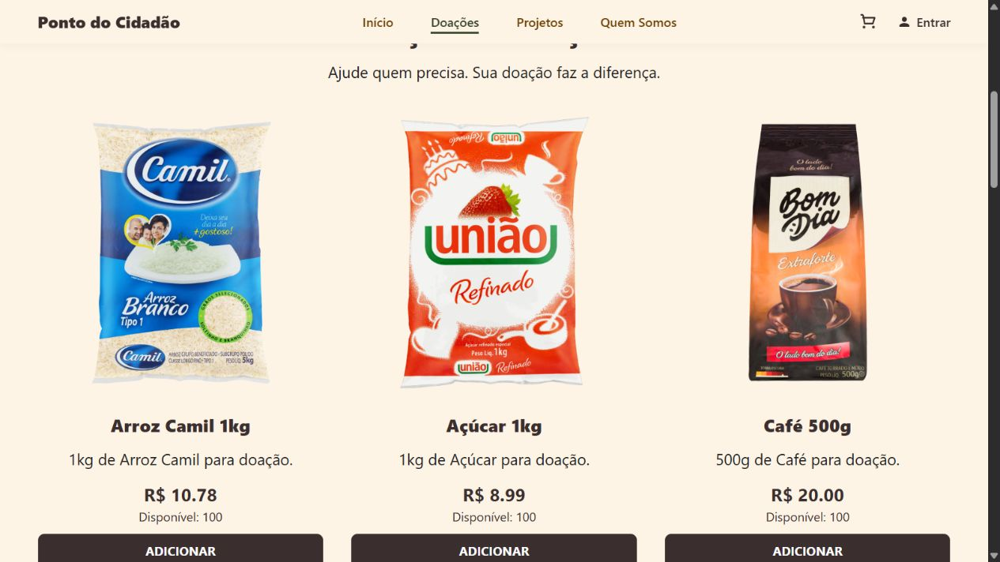

# Ponto do Cidadão

**Plataforma web para divulgação de campanhas solidárias**  
*Trabalho de Conclusão de Curso (TCC) — Técnico em Desenvolvimento de Sistemas | 2025*

[](https://www.python.org/)
[](https://flask.palletsprojects.com/)
[](#escopo-e-limita%C3%A7%C3%B5es)

**[Ver demonstração online](https://pontodocidadao1.pythonanywhere.com/)** · **[Arquitetura](docs/ARQUITETURA.md)** · **[Guia de publicação](docs/PUBLICACAO.md)**

## Sobre o projeto

O **Ponto do Cidadão** é uma plataforma web concebida como TCC para **apresentar uma iniciativa solidária, divulgar campanhas de arrecadação de alimentos e itens essenciais e facilitar a comunicação com a comunidade**. Sua proposta se volta ao apoio a pessoas em situação de vulnerabilidade social.

O trabalho foi desenvolvido em equipe em **2025** na Escola Estadual Professora Zilah Ferreira Viagi Passarelli de Campos. Em **2026**, o projeto passou por uma revisão técnica e editorial para apresentação em portfólio, com aprimoramentos na organização do código, validação de formulários, testes e documentação. A revisão não altera a autoria nem a data original do TCC.

> **Atenção:** este é um **protótipo acadêmico demonstrativo**, e não uma ONG comprovadamente em operação. Os valores do catálogo são ilustrativos; **não há cobrança real ou confirmação de pagamentos no fluxo padrão**. A versão hospedada pode diferir da versão documentada neste repositório.

## Prévia da aplicação

**Página inicial**


**Catálogo demonstrativo**



## Funcionalidades implementadas

- Páginas institucionais e apresentação de campanhas solidárias.
- Consulta a campanhas e seus detalhes.
- Cadastro, login e encerramento de sessão de usuários.
- Formulário de contato com validação e armazenamento das mensagens no banco de dados (**sem envio automático de e-mail**).
- Catálogo de alimentos e itens essenciais com preços e quantidades **demonstrativos**.
- Carrinho autenticado para adicionar, atualizar e remover itens.
- Resumo dos itens, com verificação de valores e limites feita no servidor.
- Integração **opcional e desativada por padrão** com ambiente de testes (*sandbox*) do Mercado Pago; sem confirmação de pagamento real.

## Tecnologias e ferramentas

| Área | Tecnologias |
| --- | --- |
| Back-end | Python 3.11+, Flask |
| Templates e interface | HTML, CSS, JavaScript, Jinja2 |
| Persistência | SQLite, Flask-SQLAlchemy / SQLAlchemy |
| Formulários e segurança | Flask-WTF, proteção CSRF, hash de senhas com Werkzeug |
| Testes e qualidade | pytest, Ruff, GitHub Actions |
| Versionamento | Git e GitHub |

## Arquitetura do projeto

A aplicação utiliza uma **fábrica de aplicação Flask** e separa rotas públicas, autenticação e carrinho. Os templates Jinja compartilham os elementos de interface; os modelos SQLAlchemy representam contas, contatos e produtos. As configurações de ambiente ficam fora do código-fonte.

```text
app/                    # rotas, autenticação, carrinho, modelos e serviços
  templates/            # páginas HTML com Jinja2
  static/               # CSS, JavaScript e recursos visuais
docs/                   # TCC, arquitetura, publicação e capturas de tela
  images/               # imagens usadas neste README
tests/                  # testes automatizados
.github/workflows/      # CI com GitHub Actions
config.py               # configuração por variáveis de ambiente
run.py                  # execução local
wsgi.py                 # entrada WSGI para hospedagem
requirements.txt        # dependências da aplicação
requirements-dev.txt    # dependências de desenvolvimento e testes
.env.example            # exemplo de configuração sem segredos
```

Para os detalhes sobre módulos, rotas e modelo de dados, consulte a **[documentação de arquitetura](docs/ARQUITETURA.md)**.

## Executar localmente

### Pré-requisitos

- **Python 3.11 ou superior**.
- Uma cópia deste repositório.
- Terminal PowerShell (comandos abaixo) ou shell equivalente.

### 1. Criar o ambiente e instalar dependências (Windows / PowerShell)

Execute na pasta raiz do projeto:

```powershell
py -m venv .venv
.\.venv\Scripts\python.exe -m pip install --upgrade pip
.\.venv\Scripts\python.exe -m pip install -r requirements.txt
Copy-Item .env.example .env
.\.venv\Scripts\python.exe -c "import secrets; print(secrets.token_hex(32))"
```

Copie a chave aleatória gerada para a variável `SECRET_KEY` em `.env`. Para testes locais em HTTP, configure `COOKIE_SECURE=false` e mantenha `PAYMENT_MODE=disabled`.

> **Segurança:** não publique seu arquivo `.env`, chaves de API, bancos de dados de usuários ou outros segredos.

### 2. Preparar o banco e o catálogo demonstrativo

Execute **somente na preparação de uma instalação nova**:

```powershell
.\.venv\Scripts\python.exe -m flask --app app:create_app init-db
.\.venv\Scripts\python.exe -m flask --app app:create_app seed-demo
```

- `init-db` cria tabelas ausentes; não migra a estrutura de tabelas existentes.
- `seed-demo` insere os **15 produtos demonstrativos** que ainda não existem, sem duplicar nomes nem atualizar os preços dos existentes.
- O banco padrão fica em `instance/ponto_do_cidadao.db` e **não deve ser versionado**.

### 3. Iniciar a aplicação

```powershell
.\.venv\Scripts\python.exe run.py
```

Acesse **http://127.0.0.1:5000** e utilize dados fictícios para testar cadastro, login, formulário e carrinho.

**Linux/macOS:** utilize `python3 -m venv .venv`, `.venv/bin/python` no lugar de `.\.venv\Scripts\python.exe` e `cp .env.example .env` para copiar a configuração.

## Testes automatizados

```powershell
.\.venv\Scripts\python.exe -m pip install -r requirements-dev.txt
.\.venv\Scripts\python.exe -m pytest -q
.\.venv\Scripts\python.exe -m ruff check .
```

A suíte contempla navegação, autenticação, validação do formulário de contato, regras do carrinho, proteção CSRF e respostas **simuladas** do provedor de pagamento. Os testes usam banco isolado e dados fictícios. O GitHub Actions está configurado para Python **3.11, 3.12 e 3.13**.

A revisão técnica de outubro de 2026 documentou **34 testes aprovados** em Python 3.12. Isso não equivale a auditoria de segurança, teste de carga nem certificação para operação real.

## Escopo e limitações

- A plataforma é uma **demonstração acadêmica**; informações de campanhas e valores de produtos são ilustrativos.
- O carrinho **não confirma pagamentos nem registra pedidos no fluxo atual**. O sandbox externo não foi validado com credenciais reais na revisão documentada.
- O formulário de contato **armazena mensagens**, sem disparo automático de e-mails.
- Não há painel administrativo, recuperação de senha, gestão de voluntários ou prestação de contas nesta versão.
- Não há dados que comprovem arrecadação, número de pessoas atendidas ou impacto social efetivo.
- Para uma utilização institucional real, seriam necessários processos operacionais, controles adicionais de segurança, tratamento de dados e validações de pagamentos.

## Documentação

- [Arquitetura e funcionamento do sistema](docs/ARQUITETURA.md)
- [Procedimentos de publicação e hospedagem](docs/PUBLICACAO.md)
- [Trabalho de Conclusão de Curso — Word](docs/TCC_Ponto_do_Cidadao_Revisado.docx)
- [Política e orientações de segurança](SECURITY.md)

> **Documento com logotipo da escola:** se você substituir o arquivo Word original pela versão atualizada, mantenha o nome indicado no link acima **ou atualize o link** para `docs/TCC_Ponto_do_Cidadao_Com_Logo.docx` após enviar esse arquivo à pasta `docs/`.

## Contexto acadêmico

**Instituição:** Escola Estadual Professora Zilah Ferreira Viagi Passarelli de Campos  
**Curso:** Técnico em Desenvolvimento de Sistemas — Programa Educação Profissional Paulista  
**Orientadora:** Prof.ª Esp. Valéria Fernandes Mendes  
**Local e ano do TCC:** São José dos Campos, 2025  
**Revisão técnica e editorial para portfólio:** outubro de 2026

## Autoria

Projeto desenvolvido em equipe pelo grupo **Ponto do Cidadão**:

- Felipe Riquelme Machado Nobre
- Filipe Carlin de Sousa
- João Guilherme Gonçalves da Silva
- Lucas Carlin de Sousa
- Pedro Paulo Silva dos Santos
- Yuri Pereira Gonçalves

## Recursos visuais, segurança e licença

Os recursos visuais da versão original, incluindo imagens e vídeos, podem possuir direitos de terceiros. Sua origem e autorização de redistribuição devem ser verificadas antes de compartilhar publicamente. O mesmo cuidado se aplica às capturas de tela que os reproduzem.

Credenciais eventualmente expostas em versões antigas precisam ser **revogadas**, mesmo que tenham sido removidas do código atual. Consulte [SECURITY.md](SECURITY.md).

**Licença:** nenhuma licença de código aberto foi atribuída neste momento; qualquer decisão de licenciamento deve considerar todos os autores.
