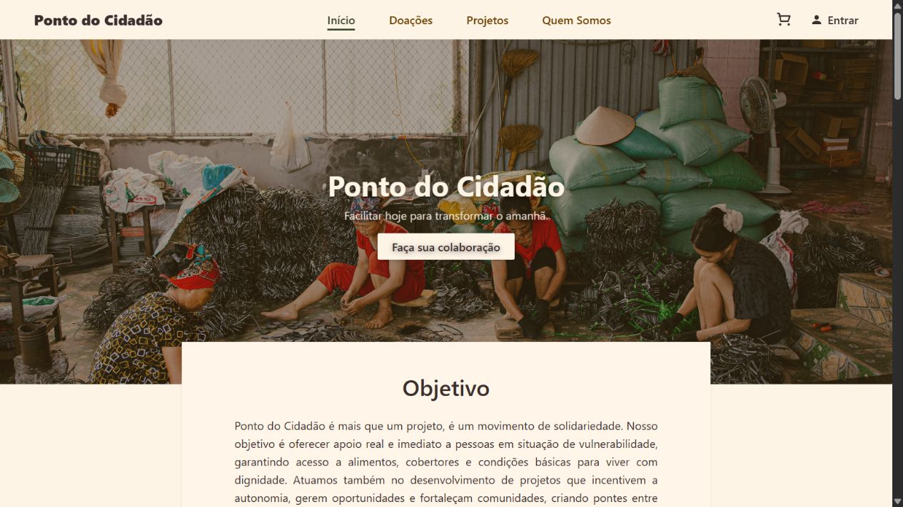

# Ponto do Cidadão

Website institucional desenvolvido como Trabalho de Conclusão do Curso Técnico em Desenvolvimento de Sistemas, em **2025**. A proposta é apresentar uma ONG, divulgar campanhas de arrecadação de alimentos e itens essenciais e aproximar a comunidade de ações voltadas a pessoas em situação de vulnerabilidade social.



**Python · Flask · SQLite · HTML · CSS · JavaScript**

## Como funciona

O visitante pode conhecer a proposta da organização, consultar campanhas e seus detalhes, visualizar o catálogo e preencher o formulário de contato. Para selecionar itens no carrinho, precisa criar uma conta e entrar no sistema.

Após o login, é possível adicionar itens, alterar quantidades, remover produtos e consultar o total no checkout. O servidor confere os preços e os limites de quantidade. O formulário de contato grava as informações no banco; não envia e-mails.

O projeto é um protótipo acadêmico. O pagamento permanece desativado por padrão e dispõe de integração opcional com o sandbox do Mercado Pago. Não há confirmação de pagamentos, reserva de estoque ou registro de pedidos no fluxo atual. As campanhas e os textos institucionais não constituem comprovação de ações realizadas pelo grupo.

## Organização

O sistema é uma aplicação Flask com páginas renderizadas no servidor. Os templates Jinja geram o HTML, o CSS define a aparência e o JavaScript controla as interações. O SQLite armazena contas, contatos e produtos, acessados por modelos SQLAlchemy.

```text
app/                 # páginas, autenticação, carrinho, modelos e serviços
  templates/         # telas HTML com Jinja
  static/            # CSS, JavaScript, imagens e vídeos
docs/                # arquitetura, publicação e TCC em ABNT
tests/               # testes automatizados
config.py            # configuração por variáveis de ambiente
run.py               # inicialização local
wsgi.py              # inicialização para hospedagem
requirements.txt     # dependências da aplicação
requirements-dev.txt # dependências de desenvolvimento e testes
.env.example         # exemplo público de configuração
```

A [documentação de arquitetura](docs/ARQUITETURA.md) detalha os módulos, as rotas, o banco de dados e os fluxos de funcionamento.

## Instalação

Requisito: **Python 3.11 ou superior**. Execute os comandos na raiz do projeto. As etapas abaixo são para uma instalação nova; preserve o `.env` e o banco caso já existam.

```powershell
py -m venv .venv
.\.venv\Scripts\python.exe -m pip install --upgrade pip
.\.venv\Scripts\python.exe -m pip install -r requirements.txt
Copy-Item .env.example .env
.\.venv\Scripts\python.exe -c "import secrets; print(secrets.token_hex(32))"
```

Copie a chave gerada para `SECRET_KEY` em `.env`. Para acesso local por HTTP, use `COOKIE_SECURE=false` e mantenha `PAYMENT_MODE=disabled`.

Prepare as tabelas e o catálogo de exemplo apenas na primeira instalação:

```powershell
.\.venv\Scripts\python.exe -m flask --app app:create_app init-db
.\.venv\Scripts\python.exe -m flask --app app:create_app seed-demo
```

`init-db` cria tabelas ausentes; não atualiza colunas existentes. `seed-demo` adiciona os 15 produtos de exemplo sem repetir nomes já cadastrados nem atualizar seus valores. Esses comandos não precisam ser repetidos para iniciar o site. O banco padrão fica em `instance/ponto_do_cidadao.db` e não deve ser publicado.

No Linux/macOS, use `python3 -m venv .venv`, `.venv/bin/python` no lugar do executável do Windows e `cp .env.example .env`.

## Executar

Com o ambiente preparado:

```powershell
.\.venv\Scripts\python.exe run.py
```

Abra [http://127.0.0.1:5000](http://127.0.0.1:5000). Crie uma conta com dados fictícios para testar o carrinho. A execução normal não carrega produtos nem modifica a estrutura do banco automaticamente.

## Testes

```powershell
.\.venv\Scripts\python.exe -m pip install -r requirements-dev.txt
.\.venv\Scripts\python.exe -m pytest -q
.\.venv\Scripts\python.exe -m ruff check .
```

Os testes verificam páginas, autenticação, contato, proteção CSRF, regras do carrinho e respostas simuladas do pagamento. Utilizam banco isolado em memória e dados fictícios, sem acessar o banco local ou o provedor financeiro. O GitHub Actions está configurado para executar a suíte em Python 3.11, 3.12 e 3.13.

## Documentação

- [Funcionamento, arquitetura e organização](docs/ARQUITETURA.md)
- [Publicação no GitHub e hospedagem](docs/PUBLICACAO.md)
- [TCC em ABNT — Word](docs/TCC_Ponto_do_Cidadao_Revisado.docx)
- [Segurança e tratamento dos dados](SECURITY.md)

## Contexto acadêmico

- Instituição: Escola Estadual Professora Zilah Ferreira Viagi Passarelli de Campos.
- Curso: Técnico em Desenvolvimento de Sistemas — Programa Educação Profissional Paulista.
- Orientadora: Prof.ª Esp. Valéria Fernandes Mendes.
- Cidade e ano: São José dos Campos, 2025.
- [Site hospedado no PythonAnywhere](https://pontodocidadao1.pythonanywhere.com/): a versão online pode diferir do código local; não é atualizada automaticamente por esta revisão.

## Autores

Grupo **Ponto do Cidadão**:

- Felipe Riquelme Machado Nobre
- Filipe Carlin de Sousa
- João Guilherme Gonçalves da Silva
- Lucas Carlin de Sousa
- Pedro Paulo Silva dos Santos
- Yuri Pereira Gonçalves

## Recursos visuais e licença

As imagens e os vídeos em `app/static/picture-movie/`, também reproduzidos nas capturas, foram herdados do projeto original. A origem e a autorização de uso desses recursos precisam ser confirmadas antes da redistribuição pública. Nenhuma licença de código aberto foi atribuída sem decisão dos autores.
