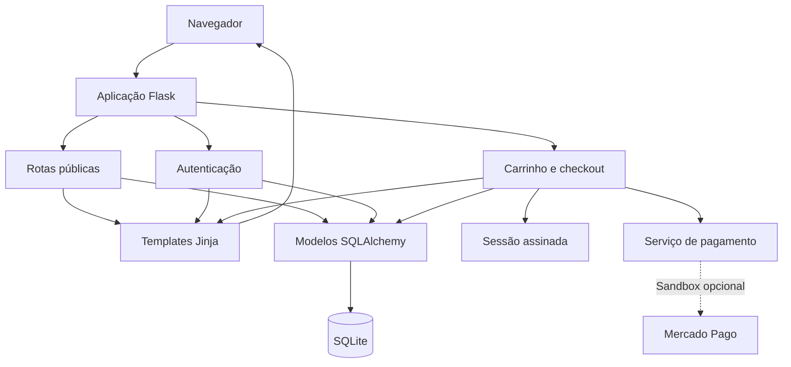

# Funcionamento e arquitetura do Ponto do Cidadão

## Visão geral

O Ponto do Cidadão é um website institucional voltado à apresentação de uma organização social, à divulgação de campanhas e à participação da comunidade. O protótipo reúne páginas públicas, contas de usuário, formulário de contato e catálogo com carrinho de contribuições.

A aplicação é um monólito modular: páginas, regras e acesso ao banco fazem parte de um único sistema Flask, organizado por responsabilidade. Não existe um frontend separado que precise ser compilado nem uma API independente para executar o site.

## Arquitetura

O navegador solicita uma página ou envia um formulário. O Flask identifica a rota, verifica os dados e consulta os modelos quando necessário. A resposta é uma página HTML renderizada pelo Jinja ou uma resposta JSON utilizada pelos controles JavaScript. O carrinho lateral é carregado como um fragmento HTML.

`create_app()` cria a aplicação, carrega a configuração, inicializa as extensões e registra o blueprint `main`. As funções desse blueprint estão distribuídas em módulos de páginas públicas, autenticação e carrinho. Essa organização permite usar a mesma aplicação na execução local, na hospedagem e em testes com configuração isolada.

| Tecnologia | Responsabilidade |
|---|---|
| Python e Flask | Requisições, validações, sessões e execução das regras |
| Jinja e HTML | Estrutura das páginas renderizadas no servidor |
| CSS e JavaScript | Apresentação e interação no navegador |
| Flask-SQLAlchemy e SQLite | Modelos e persistência dos dados |
| Flask-WTF | Proteção CSRF dos formulários e requisições de alteração |
| Werkzeug | Geração e verificação do hash das senhas |
| pytest e Ruff | Testes automatizados e análise estática |

O frontend mantém os estilos do projeto, Tailwind via CDN e fontes externas. O menu, o carrossel, o carrinho lateral e o checkout utilizam JavaScript. A aparência não depende de um processo de build.

## Organização do código

| Local | Responsabilidade |
|---|---|
| `app/__init__.py` | Fábrica da aplicação, extensões, erros, cabeçalhos e comandos de preparação |
| `app/blueprints.py` | Definição do blueprint compartilhado pelas rotas |
| `app/routes.py` | Páginas institucionais, campanhas, catálogo e formulário de contato |
| `app/auth.py` | Cadastro, login, logout, identificação da conta e controle de acesso |
| `app/cart.py` | Entrada e saída HTTP das operações do carrinho e do checkout |
| `app/services/cart.py` | Conferência dos produtos, limites e cálculo do total |
| `app/services/payments.py` | Comunicação opcional com o sandbox do Mercado Pago |
| `app/models.py` | Definição das tabelas e relações do banco |
| `app/content.py` | Conteúdo compartilhado pela lista e pelos detalhes das campanhas |
| `app/formatting.py` | Formatação dos valores em reais para HTML e respostas JSON |
| `app/catalog.py` | Dados de exemplo usados na preparação de uma instalação nova |
| `app/templates/` | Páginas Jinja e estrutura compartilhada de navegação |
| `app/static/` | Estilos, scripts, imagens, vídeos e documentos vinculados às páginas |
| `config.py` | Leitura das variáveis de ambiente e valores padrão |
| `run.py` | Entrada para execução local em `127.0.0.1:5000` |
| `wsgi.py` | Objeto `application` utilizado pela hospedagem |
| `tests/` | Verificação dos fluxos com banco e dados isolados |
| `.github/workflows/` | Execução dos testes no GitHub Actions |
| `docs/` | Documentação técnica, publicação e trabalho acadêmico |

`.venv/`, `.env`, caches e `instance/` são arquivos locais de execução, excluídos pelo `.gitignore`. Não fazem parte do código a publicar. As instruções de instalação estão no [README](../README.md).

## Funcionamento dos recursos

### Páginas e campanhas

A página inicial apresenta a proposta do projeto e o contato. As páginas institucionais e de campanhas podem ser consultadas sem login. A lista de projetos e seus detalhes usam o mesmo conteúdo de `content.py`; não há painel administrativo ou cadastro de campanhas no banco. As campanhas com destino externo exibem um link independente do carrinho e da integração de teste. As iniciativas ainda sem informações completas aparecem como “Em preparação”, sem botão de pagamento.

### Cadastro e sessão

O cadastro recebe nome, e-mail e senha. O servidor valida formato, tamanho dos campos e duplicidade da conta. A senha é armazenada como hash, nunca como texto puro. No login, a aplicação verifica a credencial e inicia uma nova sessão. A cada requisição, confere se a conta identificada ainda existe no banco.

O cookie de sessão é assinado, mas não criptografado. Ele contém identificadores e estado do carrinho; as informações completas da conta permanecem no banco. O logout utiliza POST com CSRF e limpa a sessão, incluindo os itens selecionados.

### Formulário de contato

Nome, sobrenome, e-mail e telefone são obrigatórios. Empresa, assunto e mensagem são opcionais. Após validar os campos, o servidor grava um registro em `contatos` e informa o sucesso. Não há envio automático de e-mail nem interface de atendimento às mensagens.

### Catálogo e carrinho

O catálogo consulta `products`. Cada produto possui descrição, imagem, preço em centavos e limite de quantidade. É possível escolher a quantidade antes de adicionar; produtos indisponíveis ficam desabilitados. Para adicionar um item, o usuário precisa estar autenticado. O carrinho guarda apenas os IDs e as quantidades na sessão.

Ao incluir ou alterar um item, o servidor valida a quantidade acumulada. Ao carregar o carrinho ou o checkout, consulta novamente os produtos, remove itens indisponíveis e ajusta quantidades acima do limite. Os controles da interface confirmam a alteração somente após a resposta do servidor.

O carrinho lateral mostra preço unitário, subtotal por produto e total. O contador do cabeçalho representa a soma das quantidades. A interface permite aumentar, diminuir, digitar quantidades e remover itens, respeitando o limite de estoque e o máximo de 99 unidades por produto. Um carrinho vazio oferece um caminho de volta ao catálogo.

`api.js` centraliza as requisições POST e as executa em sequência dentro da página, evitando alterações simultâneas na sessão. As respostas incluem o estado atual dos itens, os limites e os valores calculados pelo servidor. `cart.js` e `checkout.js` compartilham essas atualizações por eventos `cart:changed`, mantendo o resumo consistente quando o carrinho lateral é usado sobre o checkout. Scripts, imagens e estilos são servidos sem consultar a conta no banco.

O total é calculado com valores inteiros em centavos: duas unidades de um produto de 1.078 centavos resultam em 2.156 centavos, ou R$ 21,56. Os preços enviados pelo navegador não determinam o total. O campo `stock` limita a seleção; não implementa reserva ou baixa de estoque.

### Checkout e pagamento de teste

Abrir o checkout apenas apresenta o resumo e permite revisar as quantidades ou remover produtos. Ao remover o último item, o usuário retorna ao catálogo. Com `PAYMENT_MODE=disabled`, a página informa que nenhuma cobrança será realizada e oferece um link para conhecer as campanhas. O botão de pagamento aparece somente com `PAYMENT_MODE=sandbox`; ao acioná-lo, uma requisição POST revalida o carrinho. Com as credenciais de sandbox configuradas, o serviço envia os produtos e valores atuais ao Mercado Pago e aceita somente um endereço HTTPS de teste do provedor.

Não existe confirmação autenticada de pagamento, webhook, conciliação ou gravação de pedidos nesse fluxo. As páginas de retorno não comprovam aprovação de uma doação. A integração não está preparada para receber pagamentos reais.

## Rotas principais

| Método | Endereço | Função |
|---|---|---|
| GET / POST | `/` | Página inicial e registro de contato |
| GET | `/QuemSomos` | Apresentação institucional |
| GET | `/projetos` | Lista de campanhas |
| GET | `/projeto/<id>` | Detalhes de uma campanha |
| GET | `/doacoes` | Catálogo de produtos |
| GET / POST | `/criarconta` | Cadastro de conta |
| GET / POST | `/login` | Autenticação |
| POST | `/logout` | Encerramento da sessão |
| GET | `/cart_partial` | Fragmento HTML do carrinho lateral |
| POST | `/add/<id>` | Inclusão de produto |
| POST | `/update_cart` | Atualização da quantidade |
| POST | `/remove/<id>` | Remoção de produto |
| GET | `/checkout` | Resumo do carrinho |
| POST | `/pagamento` | Solicitação de preferência de teste |
| GET | `/compracerta`, `/compraerrada` | Páginas de retorno do provedor |

`/project`, `/about` e `/quem-somos` redirecionam links antigos. Rotas do carrinho exigem autenticação. As requisições JavaScript enviam `X-Requested-With: XMLHttpRequest` e `X-CSRFToken`; falhas de validação retornam HTTP 400 e ausência de autenticação retorna HTTP 401 com o destino do login.

## Persistência e configuração

| Tabela | Uso |
|---|---|
| `contas` | Identificação da conta, e-mail e hash de senha |
| `contatos` | Dados recebidos pelo formulário de contato |
| `products` | Produtos, preços, limites e caminhos das imagens |
| `orders` | Modelo de pedido preservado por compatibilidade; sem gravação no fluxo atual |
| `order_items` | Relação entre pedido e produto, também sem gravação no fluxo atual |

`OrderItem` referencia `Order` e `Product`. O carrinho não possui tabela própria. O banco padrão é `instance/ponto_do_cidadao.db`; outra conexão pode ser definida por `DATABASE_URL`.

| Variável | Finalidade |
|---|---|
| `SECRET_KEY` | Chave obrigatória, aleatória e com pelo menos 32 caracteres |
| `DATABASE_URL` | Endereço da conexão SQLAlchemy |
| `COOKIE_SECURE` | `true` em hospedagem HTTPS; `false` no desenvolvimento HTTP local |
| `PAYMENT_MODE` | `disabled` por padrão; `sandbox` para testes opcionais |
| `MERCADOPAGO_ACCESS_TOKEN` | Credencial externa de teste, nunca versionada |
| `PUBLIC_BASE_URL` | Endereço público HTTPS para os retornos do sandbox |

A preparação inicial usa os comandos Flask `init-db` e `seed-demo`, documentados no README. Não é necessário executar scripts de atualização antes de iniciar o site. Esses comandos não alteram colunas existentes nem substituem os dados dos produtos cadastrados. Mudanças futuras de esquema exigem backup e uma migração revisada; Flask-Migrate está inicializado, mas não há migrações versionadas no projeto.

## Manutenção

Para alterar uma página, localize seu template e os arquivos correspondentes de CSS e JavaScript. Elementos comuns ficam em `base.html`. Para alterar detalhes de campanhas, consulte `content.py` e as páginas que os apresentam. Alterações de autenticação ficam em `auth.py`; regras de quantidade e total pertencem ao serviço do carrinho, para que as rotas usem o mesmo cálculo.

Os dados de `catalog.py` servem à instalação de demonstração. Editar esse arquivo não atualiza um catálogo já existente. Não use a carga de exemplo como rotina de manutenção de um banco com dados reais.

Antes de integrar alterações, execute pytest e Ruff conforme o README. Os testes usam dados fictícios e substituem o provedor de pagamento por respostas simuladas. Os cuidados com credenciais estão em [SECURITY.md](../SECURITY.md), e os passos de hospedagem estão em [PUBLICACAO.md](PUBLICACAO.md).

O escopo atual não inclui painel administrativo, recuperação de senha, gestão de voluntários, envio de e-mail ou prestação de contas. Esses recursos dependem de implementação própria; a presença de páginas institucionais ou de modelos de pedidos não significa que estejam disponíveis.
